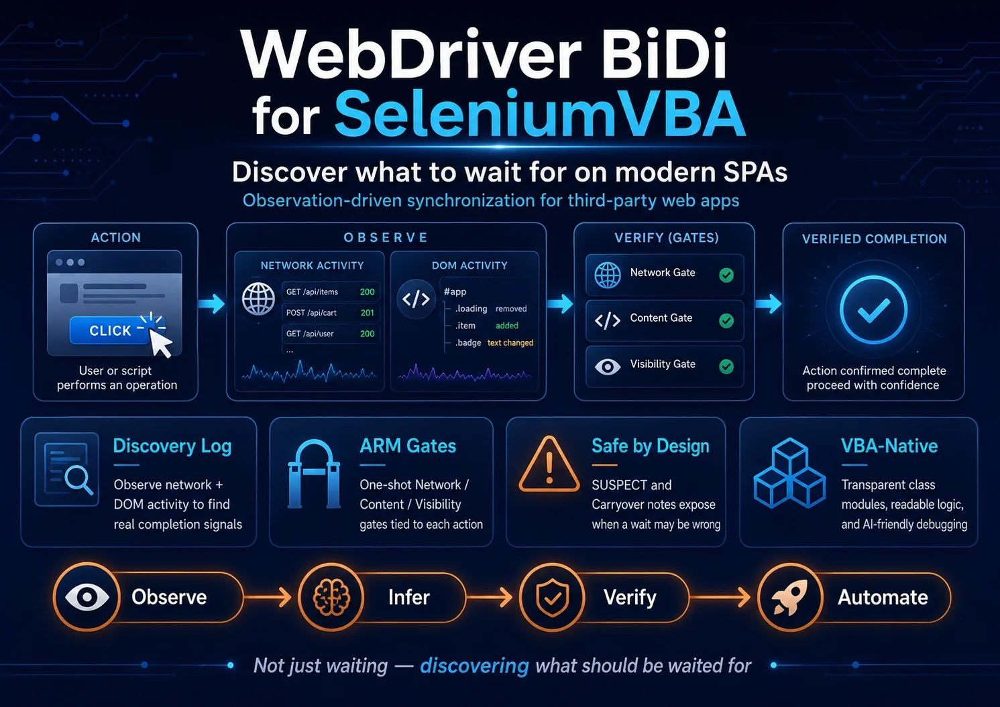
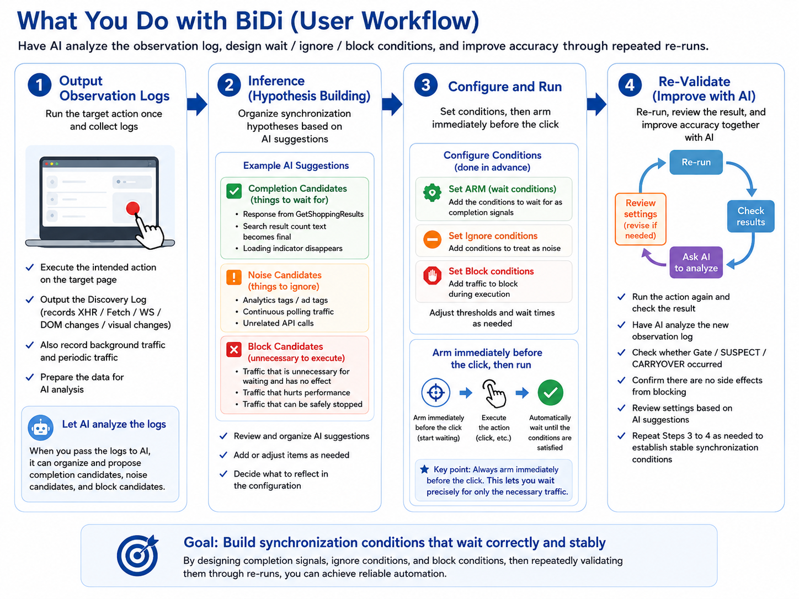

# WebDriver BiDi for SeleniumVBA v7.5

This project is a WebDriver BiDi extension for **[SeleniumVBA](https://github.com/GCuser99/SeleniumVBA)** by @GCuser99.

It is not intended to replace SeleniumVBA, Playwright, Puppeteer, or Selenium itself.  
Instead, it focuses on extending SeleniumVBA with WebDriver BiDi capabilities, especially for modern third-party SPA sites where no explicit completion signal is available.

Modern SPAs such as React, Vue.js, and enterprise web applications often update the DOM asynchronously after network responses have completed. This makes traditional VBA automation fragile, because "request completed" does not always mean "page is ready."

To address this, the tool observes network activity, Fetch/XHR activity, DOM mutations, and quiet windows to infer when the page has become stable enough for the next automation step.

Since this project assumes concurrent use of classic SeleniumVBA methods and BiDi-based observation, the BiDi API surface is intentionally kept minimal.

## Discovery Log

The Discovery Log is designed for third-party SPA sites where automation code cannot access an internal “ready” or “completed” flag.

It records network requests and responses, DOM mutation bursts, suppressed background noise, and stability diagnostics such as `domQuietMs` and `stableWindowMs`. During manual browser exploration, DOM activity is captured on the same timeline as network activity, making it possible to observe how a site changes around API calls and other asynchronous operations.

This makes it easier to determine which requests are relevant to an action, which background requests should be ignored for SPA-idle detection, which resources may be safely blocked, and whether the current wait thresholds are appropriate for the target site.

The structured log can also be provided to an AI assistant for analysis. By examining the sequence and timing of network activity, DOM updates, and stability decisions, the AI can help identify candidate completion signals, recommend suitable network, DOM, or visibility signals to arm, suggest noise-filtering or resource-blocking rules, and propose adjustments to the wait strategy.

The Discovery Log is therefore more than an execution log. It is a diagnostic and discovery tool for investigating how an unfamiliar third-party SPA behaves—and for discovering what should actually be waited for before reliable automation can be built.

**Recording what you operate (v7.2):** With `captureUserActions:=True`, the log also records each element you press, click, focus, or change during a manual recording, as `[USER-ACTION]` lines. Each line gives the element with its `id`, `role`, `name`, `aria-*`, `placeholder`, and other locator attributes, nearby ancestors and labels, the Shadow DOM host if any, and the frame. An AI can usually build working XPaths from these lines. In testing, modules generated from the logs alone ran without a single XPath correction on Hacker News search, MDN, and Google Flights, and the operated elements inside a frame were also recorded on the Japan Customs trade statistics search, a site whose frames rewrite themselves. The lines are still hints, not verified locators: check any locator that fails in DevTools (step 3 below). What you type is not recorded; only its length is.

**Recording downloads (v7.4):** A download started during the recording is written to the same timeline as `[DOWNLOAD-WILL-BEGIN]` and `[DOWNLOAD-END]`, with the suggested file name and the browser's terminal status (`complete` or `canceled`). The two lines of one download share the same `navigation` ID. In the saved log the URL goes through the same normalization as network keys, which removes most query values, and the saved path is reduced to the file name; the Immediate Window still shows both in full. Normalization keeps `rpcids` and identifier-shaped `action` values and does not touch the path, so review the log before sharing it. The `CONFIG` line shows `downloadEvents=on`, or `unavailable` if the browser refused the subscription, so a log without download lines is not mistaken for a run without downloads. An AI can use these lines to choose `ExecuteDownloads` for the clicks that started a download.

**Recording popups and new tabs (v7.5):** Actions in a popup or a new tab opened by the target page are now recorded too. This includes a popup opened by a frame, a popup that moves on to another site, and a popup opened from another popup. For each such window the log adds a `[USER-ACTION-SCOPE] status=added` line naming the context that opened it, every `[USER-ACTION]` line carries its `ctx`, and `[NAV]` lines from frames and popups now carry `ctx=other:` as network lines already did, so an AI can tell which window each action belongs to and use `ExecuteOpenNewContext` for the click that opened it. The STOP tab and tabs you open from the address bar or the new-tab button are not recorded; the end of the log only counts them. Popup recording is on whenever `captureUserActions:=True`; pass `capturePopupActions:=False` to record the target tab only. On the Japan Customs trade statistics search, where a button in a frame opens a selection popup, a module generated from the log replayed the whole search, popup included.

### Typical Workflow: From Manual Recording to Verified Automation

1. **Record the entire workflow with clear pauses between actions.** Use `Main09` to capture the complete scenario in a single Discovery Log, from the initial page load through the final result. `Main09` calls `StartDiscoveryLog` before `ExecuteNavigateAndGetStatus`, so the log also shows whether the page keeps loading data or rendering after the load event. It also turns on `captureUserActions`, so the elements you operate are recorded (v7.2), and opens a separate STOP tab (v7.3): when you have finished, switch to that tab and click **STOP RECORDING**, or close the tab. `MAX_RECORDING_SECONDS` (300) is only a safety limit. Wait until the page has fully settled after the initial load and after each action before starting the next one, so that each action's requests and DOM changes do not overlap in the log and the AI can tell the actions apart. A text field reports its change when it loses focus. Switching to the STOP tab was enough in testing on Edge; if the last input is missing from the log, press Tab before clicking STOP.
2. **Give the log to an AI assistant and have it generate a VBA standard module with provisional XPaths.** Each `discovery_log.txt` embeds its own `ANALYSIS REQUEST`, which covers network configuration (IGNORE / BLOCK), wait times, and early-STABLE suspicion. Also provide `BiDiCommandWrapper.cls` and `BiDi_Sample.bas`, and ask the AI to create a new, standalone `.bas` module implementing the recorded workflow, with the following instructions:
   - Number each action inferred from the log and describe it in a comment (for example, `' [3] Type the origin and pick a suggestion`).
   - Immediately before each action whose completion matters, arm the completion signal identified in the log (arm-then-act).
   - Build each XPath from the `[USER-ACTION]` line of that action (v7.2), using meaningful attributes such as `id`, `aria-label`, `role`, `name`, `placeholder`, `data-testid`, or a label's text. Without `[USER-ACTION]` lines, use DOM paths from the log as clues. Flag uncertain locators for manual verification.
   - Do not match `href` or `src` exactly against the value in a `[USER-ACTION]` line. The log resolves these URLs to absolute form and drops their query, so the page's own attribute is often different (for example, a relative `href`). Prefer an ancestor `id`, the visible text, or a distinctive part of the path (v7.4; the log's own `ANALYSIS REQUEST` says the same).
   - For each click followed by `[DOWNLOAD-WILL-BEGIN]`, use `ExecuteDownloads` instead of `ExecuteClick` (v7.4).
   - For actions in a context listed by `[USER-ACTION-SCOPE] status=added`, open that popup with `ExecuteOpenNewContext` and operate it with the returned context ID. Pass `ownerContextId` when the button that opens it is inside a frame. Do not wait for network idle on a click that closes its own popup (v7.5).
   - Use only APIs and argument signatures verified against the supplied source code.

   Also tell the AI the text you typed. The log records only the length of typed text, not the text itself, and network keys keep query parameter names but strip their values. The start URL is the exception: the log records it as `[NAV-TARGET]`, exactly as passed to `ExecuteNavigateAndGetStatus`. The `ANALYSIS REQUEST` tells the AI to ask you for any value the log does not contain instead of guessing it.

   Continue the following steps in the same AI conversation.
3. **Use DevTools only for locators that fail.** With `[USER-ACTION]` lines, most XPaths work on the first run. When one fails, or when the log has no `[USER-ACTION]` line for an action, give the AI a screenshot of the DevTools Elements panel showing the intended element and two or three levels of its ancestors, since the element to operate is often a parent of the visible text. If an attribute value used in the XPath is long or easy to misread, also paste that value, or the element's own outerHTML, as text. Ask the AI to construct a stable XPath from meaningful attributes such as `aria-label`, `role`, `data-*`, or non-generated `id`s, and verify that it identifies the intended visible element rather than a hidden duplicate. Once verified, a stable locator generally needs revisiting only if the site's DOM or behavior changes or the locator fails.
4. **Run, refine, and verify values.** Run the module with recording enabled and give the new log to the AI. Have the AI check for signal hits and any `[SPA-CONSENSUS-SUSPECT]`, and ask it for fixes. A successful wait does not mean the data is right, so also have it add checks of counts or text after important steps. Repeat until the workflow runs reliably.

## Validation Benchmarks

For validation, this project uses two challenging automation benchmarks: entering text into the ServiceNow login form and performing a flight search on Google Flights.

ServiceNow is frequently regarded as one of the more difficult Single Page Applications to automate because of its complex SPA behavior, extensive use of Shadow DOM, and asynchronous UI updates.

Google Flights provides another demanding benchmark. The validation scenario performs a one-way flight search from Sapporo to Paris, including interactions with dynamically generated destination suggestions, the fare calendar, and asynchronously updated search results.

These benchmarks verify that WebDriver BiDi for SeleniumVBA can reliably handle complex dynamic websites by detecting browser events and waiting for meaningful application-level completion signals rather than relying on fixed delays.

The ServiceNow validation code is contained in the `Main07` procedure, and the Google Flights validation code is contained in the `Main08` procedure.

---
## [Supported OS]
* **Windows11**
## [Supported Application]
* **Excel / Access**
## [Supported Browsers]
* **Edge / Chrome**
* *Firefox is not supported due to functional limitations.*

## Installation

Setup and import instructions are available in the **[Wiki](https://github.com/hanamichi77777/WebDriver-BiDi-for-SeleniumVBA/wiki)**.

## Scope and Limitations

* **SPA completion is inferred, not guaranteed.** The default idle consensus is based on observed network activity, Fetch/XHR counters, DOM mutations, and a quiet window. It cannot prove the target application's internal logical completion or rule out future delayed work.
* **Use explicit completion signals for important actions.** When a specific DOM rewrite or network response marks completion, arm `ArmContentSignal` and/or `ArmNetworkSignal` immediately before the action. A targeted signal is safer than relying on quietness alone. `ArmNetworkSignal` can also be armed before `ExecuteNavigateAndGetStatus` to gate the post-navigation wait; `ArmContentSignal` and `ArmVisibilitySignal` cannot, because navigation destroys their page-side observers.
* **This project is not intended for large-scale parallel browser execution.** It is optimized for precise control and observation of one browser, or a small number of sessions, rather than dozens or hundreds of concurrent browsers.
* **The browser print preview is not reachable through BiDi.** On Edge 154 (observed 2026-10-03), the print preview opened by `window.print()` (`edge://print/`) appears as a CDP target and as a classic WebDriver window handle, but not in the BiDi `browsingContext.getTree`. Operate the print dialog through classic SeleniumVBA.
* **Idle-ignore patterns require careful selection.** An overly broad `AddIdleIgnoreNetworkPattern` rule can exclude meaningful requests and cause an early `STABLE` result.
* **Limits of the manual action recorder (v7.2).**
  * Since v7.5, actions in popups and new tabs opened from the target are recorded. A popup written with `document.write`, or a same-origin popup that reuses its first blank document for the real page, gets the recorder's listeners about 0.1–0.3 s after the page's content loads (`[USER-ACTION-SCOPE] status=ensured`). Wait for a popup to settle before operating it.
  * `alert`, `confirm`, and `prompt` dialogs may close by themselves during a recording. In testing on Edge they were closed automatically as soon as they appeared. This depends on the browser and on the WebDriver session's prompt setting; the recorder does not handle dialogs itself.
  * `event=focusin` means only that an element gained focus. It also appears when focus returns to the opener after a popup closes, or after a Tab key press. Do not replay it alone as a click; the log's `LEGEND` says the same (v7.5).
  * A popup opened with `noopener` had no `[RES]` line for its page in every log taken so far, and it is reported as still open at the end of the recording. The log's `LEGEND` lists this as a known observation.
  * When no clickable ancestor is found for the operated element, the line shows `actionable=(none)` and describes the element itself (v7.5).
  * Some sites rewrite a frame's document in place (`document.open()`), which removes the recorder's listeners. `RecordEventsForSeconds` reattaches them about 0.3–0.5 s after the rewrite, so an action within that gap may be missed. The reattachment runs only during `RecordEventsForSeconds`, as in `Main09`; it does not run while automation code is executing.
  * Labels, button text, and the visible text of a selected option are recorded and may contain personal information. Review the whole log before sharing it.
  * Since v7.4 a download started during the recording is logged as `[DOWNLOAD-WILL-BEGIN]` / `[DOWNLOAD-END]`. `status=complete` is the browser's report; the file on disk is not checked.
  * A click that the page itself performs with `element.click()` is recorded in the same form as a click you made. On a page where one click starts two downloads through two script clicks, the log shows three clicks. Tell the AI which clicks you actually made, or replay code may repeat the script's clicks.
  * When the recording stops, the recorder removes its listeners from every frame. A frame that does not answer, such as some embedded social-media buttons, costs about 2 seconds each (v7.4; up to 30 seconds in v7.3) and is named in a `[USER-ACTION-CLEANUP-WARN] ctx=...` line. The listeners left in such a frame are inert. `Shutdown` may spend about 2 seconds more on the same frame and print `BiDi CRITICAL: Shutdown could not confirm ... Shadow Unlocker ...`. That message means the Shadow DOM Unlocker could not be confirmed as restored in those frames; it does not by itself mean that the browser or the connection stopped. If no frame can explain it, check the Immediate Window output before it.
* **Trusted clicks are opt-in.** `ExecuteClick` uses the synthetic `element.click()` by default (restored in v6.9). Set `UseTrustedClick = True` only for sites that reject synthetic clicks: on Google Flights, trusted clicks caused the search results page to fail ("Oops, something went wrong") in 3 out of 3 runs. Whether a site breaks under trusted clicks cannot be detected in advance; compare runs with `True` and `False` and check the Discovery Log. File dialogs, new-context capture and downloads always use trusted clicks regardless of this setting.

---

## 📂 Procedure Overview (Sample Module: `BiDi_Sample`)

These descriptions are aligned with the `BiDi_Sample` module included in WebDriver BiDi for SeleniumVBA. The procedures are learning and diagnostic examples rather than permanent integration tests for the referenced public websites. Third-party URLs, XPath expressions, ARIA labels, extension folders, and observed network endpoints can change without notice. When adapting a sample, first identify the application's real completion condition, then update XPath locators, signal patterns, noise rules, and business-level verification accordingly.

### 1. Main01: Google Translate Extension Installation through WebDriver BiDi
This procedure is intentionally limited to one task: installing the unpacked Google Translate extension into the current Chrome automation session.

* **Runtime installation instead of startup injection:** Calls `ExecuteWebExtensionInstall`, which sends the W3C `webExtension.install` command after Chrome has started. The extension itself is not passed through `caps.AddExtensions` or `--load-extension`.
* **Why classic capabilities are not used:** Branded Chrome removed the `--load-extension` flag in Chrome 137. Therefore, the traditional startup-capability approach commonly shown in older Selenium examples is not a dependable route for this unpacked-extension scenario in current normal Chrome.
* **Required browser configuration:** The sample enables BiDi and launches Chrome with `--remote-debugging-pipe` and `--enable-unsafe-extension-debugging` before connecting `BiDiCommandWrapper`.
* **Local source-path requirement:** `extensionPath` must identify the Google Translate version directory containing `manifest.json`. The version folder can change whenever Chrome updates the extension.
* **Easy diagnosis:** No navigation or SPA wait is performed. Failures are therefore normally attributable to the local path, the manifest, Chrome/ChromeDriver support, startup arguments, or enterprise browser policy rather than synchronization logic.
* **Result handling:** The raw BiDi response is written to the Immediate window. Because installation changes browser state, an ambiguous transport failure is not automatically retried.

### 2. Main02: Lazy-Load Scrolling with Best-Effort SPA Quiescence
This procedure demonstrates controlled scrolling on a page that appends content as the user moves downward.

* **Triggering lazy-loaded content:** `ExecuteLazyLoadScroll` repeatedly scrolls the page to provoke additional loading.
* **Practical completion assessment:** After scrolling, the wrapper evaluates observed Fetch/XHR activity, DOM mutations, and the stable window. This is a best-effort quiescence assessment; it does not prove that an infinite feed has been exhausted or that no future delayed work will occur.
* **Business-level verification:** After the wait, SeleniumVBA takes a DOM snapshot and counts article links. The count is useful as a manual verification result, not as a fixed expected value for the live site.
* **What to customize:** Replace the URL and final article XPath. If the site uses a dedicated “load more” response or a stable result container, consider arming an explicit network or content signal instead of relying on quietness alone.

### 3. Main03: Two-Stage Route Search, Resource Filtering, and Discovery Log
This procedure automates a live route-search workflow that requires two sequential button clicks across a page transition, while recording evidence that can be used to tune SPA synchronization.

* **Two different traffic controls:** `ExecuteEnableResourceBlocking` prevents matching requests from being sent, while `AddIdleIgnoreNetworkPattern` allows requests to continue but excludes matching background traffic from idle judgment. Blocking is stronger and can change page behavior; ignoring is appropriate for required but continuously noisy telemetry.
* **Focused diagnostic recording:** `StartDiscoveryLog` begins after the initial navigation and covers field input, the first search-button action, the resulting page transition, the second search-button action, responses, DOM mutations, and the final stability decision.
* **Action waits remain enabled:** The input and click operations keep their normal post-action waits because route fields, the intermediate transition, and final submission may trigger asynchronous work.
* **Intentional two-stage button sequence:** The prefix XPath (`starts-with`) clicks the first button. That action changes the page, after which another button with the exact ID appears and is clicked by the second call. These calls are not duplicate submissions against one unchanged element. When adapting the sample, verify that each XPath belongs to the intended page state before removing either action.
* **Covered button, intended click:** After the destination is typed, its suggestion list can cover the search button. The default synthetic click (`element.click()`) targets the button element itself, so the covering list does not intercept it. With `UseTrustedClick = True`, a pointer click at the button center would select the suggestion underneath; the hit test detects this, records `[TRUSTED-HITTEST] reason=covered` with the front element, and clicks the button itself instead, so the search still runs with the typed destination.
* **How to diagnose failure:** Inspect the Discovery Log before adding fixed delays. Determine whether the problem is an incorrect XPath, a transition that did not complete, relevant traffic excluded as noise, an untracked completion response, or a render that occurs after apparent network quiet.

### 4. Main04: Manual Login Wait Using URL and Post-Navigation Activity
This procedure opens a login page, lets the user authenticate manually, and waits for the browser to reach the expected authenticated URL.

* **No arbitrary `Sleep`:** `ExecuteIsUrlContains` repeatedly checks the current live URL while the wait engine also observes navigation and network activity until a match or timeout occurs.
* **Idle-aware success condition:** The sample uses `waitNetworkIdle=True`, so a matching URL alone is not treated as sufficient; the configured post-navigation activity must also reach the wrapper's wait conclusion.
* **Manual credentials by design:** Credentials are not automated. The user must submit the login form within the configured 30-second window.
* **Role in generated automation:** For sites with multi-factor authentication or new-device checks, place this pattern at the start of a generated module: the user logs in manually, and the automated steps begin after `ExecuteIsUrlContains` confirms the authenticated page. No credentials are kept in the code or the environment.
* **What to customize:** Replace the login URL, expected URL fragment, and timeout. If an identity provider keeps the same URL after authentication, use a stable authenticated DOM/content signal instead of URL matching.

### 5. Main05: Choosing Whether an Action Needs a Post-Action Wait
This procedure demonstrates that not every browser action needs the same synchronization policy.

* **Known synchronous actions:** Text entry and a color-button click use `waitForCompletion=False` on the Selenium test page because those specific actions are not expected to start relevant asynchronous work.
* **Asynchronous action retained:** The “Add Label” click keeps the normal wait and requests a 1000 ms stable window because it triggers a delayed DOM update.
* **One-shot verification:** `Debug.Assert` checks that the resulting element contains `Done!` after the action wait. This is a business-level assertion, not another polling loop.
* **Adaptation rule:** Disable the post-action wait only when the target application's behavior is known. Using `False` merely to increase speed can reintroduce race conditions.

### 6. Main06: Iframe Browsing-Context Discovery without Selenium Frame Switching
This procedure targets an element inside an iframe by passing a WebDriver BiDi browsing-context ID directly to the action.

* **Context discovery by URL:** `GetIframeContextIdByUrl` searches the current context tree for a child frame whose live URL contains the supplied fragment.
* **Explicit action scope:** The returned context ID is passed to `ExecuteClick`, so the lookup and click run in that frame without changing SeleniumVBA's active frame.
* **What to customize:** Replace the top-level URL, iframe URL fragment, and in-frame XPath.
* **How to diagnose failure:** Check the frame's actual post-navigation URL and hierarchy. Redirects, dynamically generated URLs, and additional nesting can make an old fragment stop matching.

### 7. Main07: Consent Auto-Clicker, Shadow DOM, and Explicit Network Gate
This procedure is the ServiceNow validation scenario and combines several features needed for a difficult third-party SPA.

* **Pre-navigation auto-clicker:** `ExecuteRegisterAutoClicker` is registered before navigation so the browser-side helper can dismiss the consent banner as soon as it appears.
* **Shadow DOM interaction:** `ExecuteClick "//*[@id='utility-sign-in']//button", searchShadow:=True` locates the sign-in button inside encapsulated web components with a single XPath. The wrapper descends through every ShadowRoot recursively. The same `searchShadow:=True` parameter is available on every API that takes an element XPath, including `ExecuteRegisterAutoClicker`, `ArmContentSignal`, and `ArmVisibilitySignal`.
* **Arm-then-act network gate:** `ArmNetworkSignal "metadata/application"` is called immediately before the Shadow DOM click. The one-shot signal belongs to the next action wait and helps bridge the transition into the sign-in experience.
* **End-to-end diagnostic log:** Recording starts before registration and navigation, allowing the log to preserve the consent action, navigation, armed response, mutation tail, and final username input.
* **Site-specific details:** The consent XPath, Shadow DOM XPath, username XPath, and network pattern are observations from the current ServiceNow implementation, not universal authentication signals.

### 8. Main08: Google Flights Heavy SPA Stress Sample
This procedure demonstrates how multiple synchronization techniques can be combined on a highly reactive live SPA.

* **Plain locators:** The sample favors ARIA roles and accessible labels over obfuscated CSS classes and sets `--lang=en`. Google keeps hidden duplicates of some controls (for example a second, 0×0 "Done" button); since v6.5 an action whose XPath matches several elements uses the first visible match, so the XPaths need no `[last()]`, `aria-hidden` filters, or positional indexes.
* **Date by meaning, not position:** The departure date is one week from today. The sample builds it with `Format$(Date + 7, "yyyy-mm-dd")` and selects the calendar cell by its `data-iso` attribute instead of counting grid cells.
* **Default click mode:** The sample runs with the default synthetic clicks. With `UseTrustedClick = True`, Google Flights showed "Oops, something went wrong" on the results page, and enabling trusted clicks on only some of the clicks still broke the "Cheapest" recalculation.
* **Active-element-aware input:** `ExecuteInputValue` uses the wrapper's active-element-aware input flow to clear, type, and validate values while the framework may replace controls.
* **Traffic classification:** Non-essential resources are blocked, while required background requests are merely ignored for idle judgment. The Discovery Log remains the evidence source for revising both lists.
* **Suggestion-selection gates:** Immediately before clicking the Sapporo suggestion, the sample arms `rpcids=tDoGIe`; immediately before clicking the Paris suggestion, it arms `rpcids=BVAT3`. Each click also requests a 1000 ms stable window. These signals were discovered from the current live workflow and may change independently.
* **Calendar and result gates:** Before opening the departure calendar, the sample arms the `GetCalendarPicker` network signal and the visibility signal `//div[@data-gs]`. Before pressing Search, it arms `GetShoppingResults`. All `Arm*` signals are one-shot observations rather than stable public APIs.
* **Live-site limitations:** City suggestions, calendar-cell attributes, button labels, endpoint names, consent state, locale, and account state may change. Update XPath locators and signals from a fresh log instead of adding arbitrary delays.
* **Expected outcome:** The example demonstrates a robust diagnostic strategy, but it cannot guarantee immunity from future Google UI or backend changes.

### 9. Main09: Manual Discovery Log Recorder
This procedure records the initial page load and the manual browser actions that follow in a single observation window.

* **Target URL:** An input box asks for the URL at startup (default: `https://note.com/`), so no code change is needed to record another site.
* **Pause between actions:** A single run may cover several actions or a whole scenario. After each action, wait until the page has fully settled before starting the next one, so each action's requests and DOM changes form a separate block on the timeline.
* **What the log captures:** It records the BiDi/network and SPA-probe evidence used by this project, including requests/responses, DOM activity, suppressed noise, armed-signal events, and stability decisions. It should not be described as a dump of every possible browser event.
* **Filtering is not blocking:** `excludeImagesAndCss=True` removes common image/CSS entries from the saved diagnostic stream; it does not prevent those resources from loading in the page.
* **Recording starts before navigation:** `StartDiscoveryLog` is called before `ExecuteNavigateAndGetStatus`, so the log shows whether the page keeps loading data or rendering after the load event. Wait until the page has settled before the first manual action, so the initial load forms its own block on the timeline.
* **Elements you operate (v7.2):** `captureUserActions:=True` records each click, focus, and change as a `[USER-ACTION]` line with the element's locator attributes, so an AI can build XPaths from the log. Typed text is recorded as its length only. A text field reports its change when it loses focus. Switching to the STOP tab was enough in testing on Edge; if the last input is missing from the log, press Tab before clicking STOP.
* **Start URL kept as entered (v7.1):** The URL entered at startup is recorded as `[NAV-TARGET]`, including its query values and fragment, so code generated from the log can open the same page. The line is not redacted; review it before sharing the log.
* **Ending the recording (v7.3):** After the page loads, `Main09` opens a second tab titled *BiDi Recorder - Stop*, then brings the target tab back to the front. Work in the target tab. When finished, switch to the STOP tab and click **STOP RECORDING**, or close the STOP tab with ×. The log records which one ended the recording as `[DISCOVERY-STOP] source=control-tab` or `source=control-tab-closed`. Nothing is added to the target page, and the STOP click is not recorded as a user action.
* **Safety limit:** `MAX_RECORDING_SECONDS` (default: 300) counts from when the STOP tab is opened. If neither STOP nor × is used, recording ends there with `[DISCOVERY-STOP] source=time-limit`.
* **Popups and new tabs (v7.5):** Actions in popups and new tabs opened from the target page are recorded with their own `ctx`. Each such context first appears as `[USER-ACTION-SCOPE] status=added`, with the context that opened it. The STOP tab and unrelated tabs are left out and only counted in `[USER-ACTION-SCOPE-STATS]` at the end of the log. Dialogs (`alert`, `confirm`, `prompt`) may close by themselves while recording; see *Limits of the manual action recorder*.
* **Downloads (v7.4):** Files you download during the recording appear as `[DOWNLOAD-WILL-BEGIN]` and `[DOWNLOAD-END]`, paired by `navigation` ID. The saved log keeps only the file name of each download, not its folder.
* **Saving after STOP (v7.4):** On pages with embedded widget frames, saving could take a minute in v7.3 because each frame that did not answer the listener cleanup waited 30 seconds. v7.4 waits at most 2 seconds per frame; on the Aichi Prefecture price statistics page, cleanup after STOP fell from about 60 seconds to about 4 seconds.
* **How to use the result:** Use `discovery_log.txt` to decide what should be blocked, ignored, armed, or verified. Do not choose a completion signal from its name alone; confirm its timing and relation to the resulting DOM change.

### 10. Main10: Content-Signal Gate for the Settle-to-Render Gap
This procedure demonstrates `ArmContentSignal` for cases where a response settles before an existing results container is rewritten.

* **Arm-then-act pattern:** The sample arms the existing target `//*[@id='table-body']` immediately before each year click. The next relevant SPA wait is gated on observing that subtree change in addition to the normal idle conditions.
* **Existing-target requirement:** The target XPath must already exist when armed. This signal is not appropriate for an element that is created only after the action; choose an existing parent container or another completion signal instead.
* **One-shot consumption:** Each armed signal is consumed by the next relevant wait, so the sample must re-arm before the second year click.
* **Fail-fast configuration:** A missing target at arm time raises immediately, exposing a mistyped or obsolete XPath instead of silently creating a meaningless wait.
* **Noise filtering:** Known background telemetry is ignored for idle judgment so unrelated traffic does not prevent the content-gated wait from settling.
* **What to customize:** Choose a stable existing subtree whose rewrite genuinely marks business completion. Avoid broad ancestors that also mutate for animations, clocks, advertisements, or unrelated telemetry.

### 11. Main11: Short-Lived File Input Selection with an Application-Level Completion Gate
This procedure demonstrates the file-selection path for applications that create an `input[type=file]` only when the user clicks a visible trigger and remove that input immediately after opening the file chooser.

* **Self-contained sample file:** SeleniumVBA creates `sample.txt` at runtime with `SaveStringToFile`, so the example does not depend on a separately prepared local test file.
* **HTTPS test fixture:** The sample uses the project's public GitHub Pages file-dialog probe rather than a local `file://` fixture. The page provides a reproducible top-level HTTPS environment for the short-lived file-input pattern.
* **Trigger element instead of file-input XPath:** `ExecuteSetFileSelectionViaDialog` receives the XPath of the visible file-selection button. The underlying `input[type=file]` does not need to remain discoverable in the DOM; the page creates it, calls `input.click()`, and removes it immediately.
* **BiDi-based file selection:** The wrapper captures `input.fileDialogOpened`, obtains the event's element SharedReference, and uses `input.setFiles` to apply the requested local file.
* **Application completion is separate from file selection:** A successful `input.setFiles` command confirms browser-side file selection, but it does not prove that the target application has accepted or finished processing that selection. The sample therefore arms an explicit completion signal before starting the composite action.
* **Arm before act:** The test page exposes `#done` only after its file-input `change` handler runs, so `ArmVisibilitySignal "//*[@id='done']"` is armed before `ExecuteSetFileSelectionViaDialog`. On a real application, replace this with the network, content, or visibility condition that genuinely represents application completion.
* **The trigger click does not consume the completion signal:** Opening the file dialog is only an intermediate step of the composite operation. The wrapper therefore does not perform the normal SPA completion synchronization after the trigger click; the armed one-shot signal is preserved until after `input.setFiles`, when the application-side result can actually occur.
* **Discovery Log as the adaptation tool:** When applying this pattern to an unknown site, use the Discovery Log to observe what happens after file selection and identify a reliable `ArmNetworkSignal`, `ArmContentSignal`, or `ArmVisibilitySignal`. Prefer a signal causally tied to the selected file over broad background activity or arbitrary delays.
* **Chromium-specific native-picker suppression:** On Edge/Chrome, CDP is used internally only to suppress the native file chooser without intentionally generating a cancel operation. WebDriver BiDi remains responsible for `input.fileDialogOpened` and `input.setFiles`.
* **What to customize:** Replace the probe URL, trigger XPath, and completion signal when adapting the sample to a real application. The key rule is that the completion condition should represent application acceptance or completion, not merely successful execution of `input.setFiles`.

### 12. Main12: Unified Correlated Multiple-Download Observation and Destination Control

This procedure demonstrates the unified WebDriver BiDi download API using a reproducible GitHub Pages fixture. It dispatches three independent browser-download triggers, correlates each `browsingContext.downloadWillBegin` with its matching `browsingContext.downloadEnd`, waits for all accepted transactions to reach a terminal state, records the signal chain in the Discovery Log, and returns one batch-shaped `Dictionary`.

* **HTTPS multiple-download fixture:** The sample uses the project's public GitHub Pages download probe at `docs/download-probe/index.html`, published as `https://hanamichi77777.github.io/WebDriver-BiDi-for-SeleniumVBA/download-probe/`. The current fixture exposes three deterministic triggers: `#download-a`, `#download-b`, and `#download-c`, producing `bidi-batch-A.bin`, `bidi-batch-B.bin`, and `bidi-batch-C.bin`.
* **Explicit destination folder:** The sample resolves `.\download-sample` through SeleniumVBA's `ResolvePath(..., False)`, creates the folder when necessary, and passes it to `SetDownloadFolder`. `SetDownloadFolder` performs its own API-boundary path normalization and existence check before sending `browser.setDownloadBehavior`.
* **One unified API for one or many downloads:** `ExecuteDownloads` accepts either a single XPath String or a collection/array of trigger XPaths. Main12 passes an array containing the three download triggers. A single download uses the same API and the same result structure, for example `ExecuteDownloads("//*[@id='download-a']")`. There is no separate single-download execution path.
* **All trigger XPaths are resolved before dispatch:** The wrapper resolves every requested XPath before arming the download batch. If an XPath cannot be resolved, the operation fails before any download trigger is clicked, avoiding a partially dispatched batch.
* **Sequential trusted clicks, overlapping download lifetimes:** Trigger clicks are dispatched sequentially and exactly once through the trusted-click path; a trigger whose center is covered by another element falls back to a synthetic click, which the Discovery Log records as `[TRUSTED-HITTEST]`. The wrapper does not wait for each transfer to finish before dispatching the next trigger, so previously started downloads may still be running while later triggers are clicked. Ambiguous or failed click outcomes are not handled by replaying the trigger.
* **Per-download correlation:** Each accepted `downloadWillBegin` becomes an individual transaction inside the returned `downloads` Dictionary. When the browser provides a usable download identifier, it can be used for correlation. When it does not, the wrapper can correlate by owner browsing context plus navigation identity. Main12 displays each transaction's correlation key, `correlationMode`, `suggestedFilename`, terminal `status`, and browser-reported `filePath`.
* **Batch-shaped result for both one and many downloads:** The outer result includes `status`, `expectedCount`, `dispatchCount`, `startedCount`, `terminalCount`, `completeCount`, `canceledCount`, and `downloads`. The same outer structure is returned even when only one trigger XPath is supplied.
* **Batch terminal semantics:** The batch result is `complete` only when every accepted download reports `complete`. If one or more accepted downloads reach the browser-reported `canceled` terminal state, the batch returns normally with `status="failed"` and the corresponding canceled count. Structural failures such as missing start events, event loss, an unexpected number of started downloads, completion timeout, click failure, or a filename collision raise an error instead of being converted into an ordinary canceled result.
* **Owner-context isolation:** A download batch belongs to one browsing context. Download events from foreign browsing contexts are ignored rather than being mixed into the active batch.
* **Same-filename collision protection:** Multiple accepted downloads in the same batch must not report the same non-empty `suggestedFilename`. The wrapper treats that condition as a structural filename-collision error because concurrent downloads targeting the same destination path may overwrite an earlier artifact even when the browser reports the protocol transactions as complete. Once such a collision is observed, remaining trigger clicks are not dispatched.
* **Discovery Log preserves the complete signal chain:** `StartDiscoveryLog` is called before navigation and `StopAndSaveDiscoveryLog` after the batch result is obtained. This preserves lines such as `DOWNLOAD-BATCH-ARM`, `DOWNLOAD-BATCH-START-ACCEPTED`, `DOWNLOAD-BATCH-END-MATCHED`, filename-collision diagnostics, context-mismatch diagnostics, and other structural failure information even when Immediate-window debug output is not being relied upon. Since v7.4 the log shows only the file name in `filepath=` on `[DOWNLOAD-END]` and `[DOWNLOAD-BATCH-END-MATCHED]`, so it can be shared without revealing local folders; the Immediate Window and the returned `filePath` keep the full path.
* **Browser-authoritative terminal status:** Each transaction's `status` comes from its matching `downloadEnd`. Values such as `complete` or `canceled` are treated as the browser's terminal report; the sample does not infer a more specific reason for cancellation.
* **Browser-reported filepath only:** Each transaction's `filePath` is displayed as reported by WebDriver BiDi. The sample does not treat that value as proof that the file currently exists on disk, has a particular size or hash, or will never be renamed, replaced, or removed by another process.
* **Cleanup of browser-side download policy:** After displaying the batch result, `ClearDownloadBehavior` explicitly restores the browser's default download behavior. `Shutdown` also retains a best-effort cleanup path if a wrapper-owned download override is still active.
* **What to customize:** Replace the probe URL, trigger XPath or XPath array, destination folder, and timeouts when adapting the sample. For multiple downloads, use independent triggers whose expected files have distinct filenames. Use a single String XPath when only one download is expected; no separate download method is required.

### 13. Main13: Correlated New Tab / New Window Capture and Explicit Context Ownership
This procedure demonstrates capturing a newly created top-level browsing context after one trigger click, identifying whether it is a tab or a separate window, and explicitly controlling which top-level context is treated as the wrapper's main context.

* **HTTPS new-context fixture:** The sample uses the project's public GitHub Pages probe at `https://hanamichi77777.github.io/WebDriver-BiDi-for-SeleniumVBA/new-context-probe/`. The page provides separate `#open-tab` and `#open-window` triggers so tab and window creation can be exercised deterministically.
* **Resolve, arm, then click exactly once:** `ExecuteOpenNewContext` resolves the trigger element before arming capture, snapshots the current top-level context tree, then performs one trusted click and waits for `browsingContext.contextCreated`. A timeout or ambiguous outcome does not cause the trigger to be replayed.
* **Owner correlation:** When `originalOpener` is present, a new top-level context is accepted only when its opener is the owner context that was armed or, since v7.5, another frame in the owner's tab. The second case covers pages where a button in one frame opens the window through a script in a sibling frame, as on the Japan Customs trade statistics search. The result's `openerScope` reports `owner` or `same-tab`. Contexts opened by other tabs are ignored. If `originalOpener` is unavailable, the wrapper falls back to identifying a context that did not exist in the pre-click top-level baseline.
* **Ambiguity is rejected rather than guessed:** If more than one new top-level context matches the single trigger, the operation fails instead of arbitrarily choosing one. Capture also fails if relevant lifecycle events are lost after the arm boundary or if the candidate context is destroyed before capture completes.
* **Tab/window classification from `clientWindow`:** The returned `Dictionary` reports `kind` as `tab` when the captured context shares the owner's `clientWindow`, `window` when it has a different `clientWindow`, and `unknown` when the browser does not provide enough information. The result also exposes `context`, `url`, `originalOpener`, `clientWindow`, `ownerContext`, `ownerClientWindow`, `correlation`, `candidateCount`, `foreignIgnored`, and `openerScope` (v7.5).
* **Captured does not mean silently retargeted:** Opening a new context does not automatically replace the wrapper's pinned main context. The sample closes the captured tab directly by context ID, reads the new window's title with `ExecuteGetTitleByContextId`, explicitly pins that window with `SetMainContextId`, then restores the original owner context before closing the window.
* **What to customize:** Replace the probe URL, trigger XPaths, and timeouts when adapting the sample. Keep the one-trigger/one-new-top-level-context contract; if one action intentionally opens multiple tabs or windows, use an application-specific strategy rather than treating the result as a single captured context.

---
